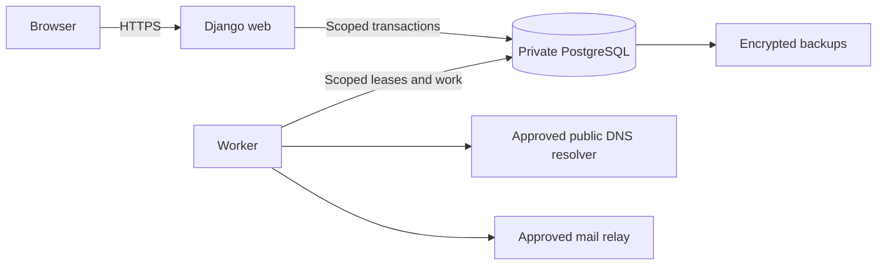

# Technical requirements

## Stack and deployment

Use a modular Django monolith with server-rendered HTML and progressive enhancement, Python 3.13, Django 5.2 LTS and PostgreSQL 17. One OCI image runs a web process and a distinct background worker deployment. PostgreSQL holds transactional state, row isolation and bounded durable jobs. The TLS proxy fronts only the web service. Run the worker entry point under separate service identities for DNS, mail and internal lifecycle jobs. DNS can reach only its configured public resolver, mail only its configured relay and internal jobs only the database. Reuse the same image and deployment unit where the hosting platform can prove equivalent isolation. Document a Compose-based Linux self-host path. Provider, location, email and MFA packages are approval or implementation decisions. This layout avoids a separate SPA, broker and object store at pilot scale. Source review on 17 November 2026. [Django support and releases](https://www.djangoproject.com/download/) · [Django compatibility](https://docs.djangoproject.com/en/5.2/releases/5.2/) · [Python version status](https://devguide.python.org/versions/) · [PostgreSQL lifecycle](https://www.postgresql.org/support/versioning/)

Suggested modules are identity, workspaces, assessments, actions, domains, reports and operations. Views and forms call domain services for transactions and decisions. Catalog content is versioned and shipped with the repository. Lock versions and image digests at kickoff, use supported security patches, run advisory and license checks in CI, and rehearse upgrades.

## Contracts

Same-origin reads use GET and mutations use POST with CSRF, field allowlists and transactional validation. Creation commands accept server-generated form idempotency keys scoped to actor, operation and tenant. Each editable object has a revision. Use 303 on success, 400 for invalid fields, 409 for stale updates, and 429 with a retry interval for caps. Out-of-scope resources return 404. A known workspace role denial can return 403 after membership is established.

| Workspace route | Contract |
|---|---|
| / and /assessments/{id} | Dashboard, draft creation, save individual answer, submit |
| /actions and /actions/{id} | Filter, inspect guidance, transition status with expected revision |
| /domains and /domains/{id} | Owner adds, requests verification/check or revokes. Scoped job status can be refreshed |
| /reports and /reports/{id} | List, preview, create, open or revoke snapshot |
| /settings/members and /settings/data-requests | Owner invites, removes, and requests export or closure |
 
Public routes provide signup via invitation, sign-in, recovery, legal/help, and minimal health. Invitation and recovery links are short-lived, single-use and bound to identity, with explicit POST redemption. Use server sessions, host-scoped Secure/HttpOnly/SameSite=Lax cookies, rotation on sign-in and invalidation on reset. Require a maintained second-factor integration for hosted owners and operators, with recovery codes and tested recovery. Privileged operators authenticate separately and public Django admin is disabled.

## Trust boundaries

Server reads current membership and scopes every object, action, export and worker request. Reject browser-provided roles and results. The server validates transitions and revisions and recalculates score, action priorities, quotas and proof eligibility. Client code formats and previews values. Use parameterized database access, escaped templates, set host/proxy allowlists and CSP, disable debug and public source maps, restrict telemetry and classify browser-delivered configuration as public. Secrets, DB connectivity and signing keys stay server-side. Private pages and reports are no-store. Static assets may be cached by content hash.

DNS tasks use only the fixed public record checks in FR-05, an approved resolver, and verified ownership with expiry and revocation checks. The process cannot fetch arbitrary URLs or contact target web services. Queue isolation and bounds are in the [schema](05-backend-schema.md) and [threat model](08-threat-privacy-and-abuse.md).

| ID | Pilot target |
|---|---|
| NFR-01 | Enforce server authorization with tenant isolation at the database boundary and scoped worker access. Zero critical auth, isolation or unauthorized-domain failures. |
| NFR-02 | Target WCAG 2.2 AA. Core flows work at 320 CSS px with keyboard, touch and screen reader. |
| NFR-03 | At 20 concurrent sessions and 10 tenants, p95 dashboard and save server latency ≤500 ms. Critical initial route ≤200 KiB compressed, LCP p75 ≤2.5s on a repeatable 1.6 Mbps / 150 ms RTT / 4× CPU slowdown profile. |
| NFR-04 | 99.5% monthly sign-in and assessment availability. 24h RPO and 4h RTO. DNS/mail failures are independently contained. |
| NFR-05 | Apply documented data retention, export, deletion, redaction and backup isolation. |
| NFR-06 | Verify supported pinned dependencies, reproducible releases, rollback and restore, and ship an SBOM. |
| NFR-07 | Bound DNS use and spend. Enforce the checks flag server-side. Verify with synthetic responses and a project-controlled DNS zone. |

Define access lifetimes at build kickoff with conservative defaults of 48 hours for invitations, 30 minutes for recovery links, and 12 hours absolute session lifetime for the hosted pilot. Rate-limit auth per account and client, with bounded recovery and invite delivery budgets. Add Django deployment checks and PostgreSQL integration tests to CI, including verification under the actual runtime database roles.

Track request latency, error categories, queue age, health and deployment version using opaque correlation IDs. Establish measured limits before scaling web or worker services.
