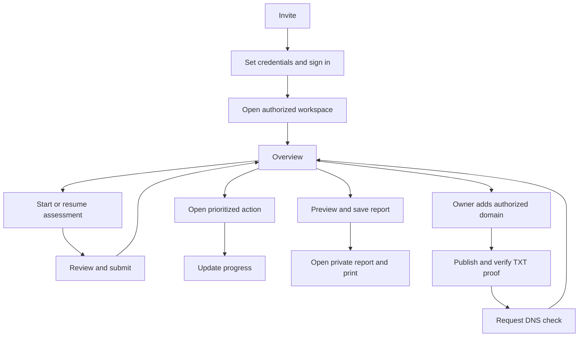

# App flow

| Starting point | Outcome | Alternate and recovery path |
|---|---|---|
| Pilot invite | Activate intended identity, enroll second factor if required, enter workspace | Used/expired invite links lead to sign-in or reissue request. Wrong account can sign out. Disabled account goes to support |
| Workspace switcher | List memberships and resolve selected workspace on server | Removed workspace returns an access message and valid choices. Deep links follow the same checks |
| Owner settings | Send contributor invite or remove existing contributor | Reissuing retires the pending link. Removed users lose private route access on their next request. Owner handover is handled by verified support in pilot |
| Assessment | Create/resume one draft, save and navigate, review, submit, return to dashboard | On disconnection preserve current form in memory until navigation or refresh and show retry. Server retains last confirmed answer. On conflict reload saved state and let the user reapply edits. Duplicate submit returns existing result |
| Actions | Filter, inspect rationale and guidance, change status | Stale changes show current state and retry option. Reopen keeps prior timeline. Source evidence remains visible when an action changes |
| Domains | Owner attests, publishes proof, requests verification, then requests check | Expired or failed proof offers renewal. A disabled feature shows last permitted observations and reason. Worker failure shows inconclusive or retry. Revocation stops future checks and invalidates pending results |
| Reports | Preview the current snapshot, persist and then print | If changes occur after preview, regenerate preview before saving. Removed members, revoked reports and closed workspaces have no access |
| Data requests | Owner requests export or closure. Support verifies identity and authority | Keep status visible until closure takes effect. Confirm receipt and completion by email with no sensitive contents. Offline support handles failure or removal of last owner |

Contributors enter Overview, Assessment, Actions, read-only Domains and Reports. Owner changes stay in Settings. Each private route enforces access for deep links and postbacks. Sign-out clears the active session, and back navigation must not display cached private data. Email contains an invite, recovery link or request status only.
